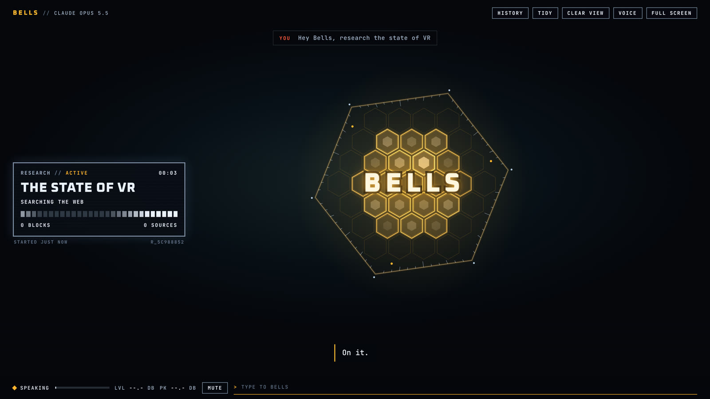
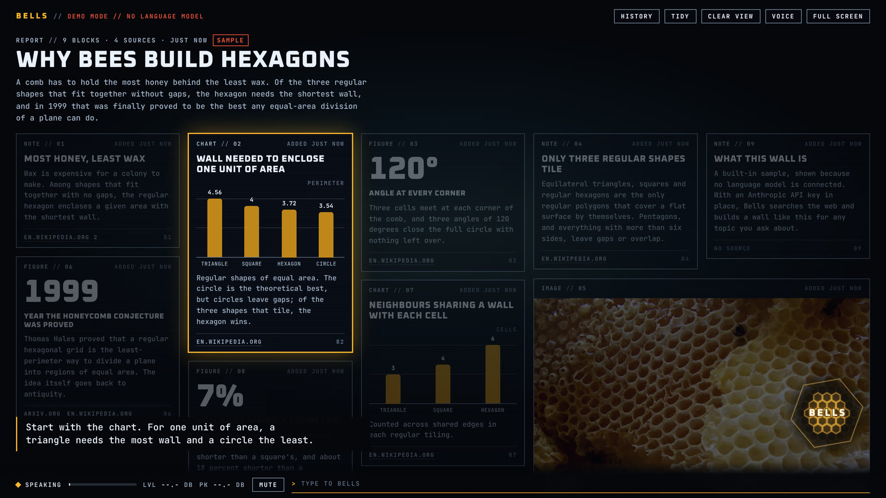

# Bells

A voice assistant that lives on a heads-up display. Say **"Hey Bells"**, ask her to look into something, and she hands the job to a research agent, tells you when it lands, puts the report on screen as a wall of blocks and talks you through it.




Her face is an animated honeycomb: it breathes when idle, ripples with your voice while she listens, lifts apart into a turning gyroscope while she thinks, and pulses with her own voice when she speaks.

Bells is an independent build inspired by the teaser of Huw Prosser's assistant "rose" ([video](https://www.tiktok.com/@huwprosser/video/7702239095396764950)). It shares the idea, not any code or artwork.

## Run it

You need Node 20.12 or newer, and Chrome or Edge for the voice parts.

```bash
cd bells
npm install
cp .env.example .env      # then put your Anthropic API key in it
npm start
```

Open <http://127.0.0.1:4317>, click **Wake her up**, allow the microphone, and say "Hey Bells".

With no API key she still starts, in a clearly labelled demo mode: scripted replies and one built-in sample report, so you can see the whole display work before spending anything.

## Talking to her

| You do | What happens |
|---|---|
| Say "Hey Bells, ..." | She wakes and takes the rest of the sentence as the request. "Hey Bells" alone works too; she chimes and waits. |
| Press **Talk** | Starts listening without the wake word. Press it again to stop. |
| Answer after she speaks | For about twelve seconds after she finishes, she listens without the wake word, so "yes, put it up" just works. |
| Hold the space bar | Talk without the wake word. Release to send. |
| Type in the bar at the bottom (or press `/`) | Same as speaking. |
| Press Esc, or click her | Stops her mid-sentence. Clicking her when she is quiet toggles listening. |

The text box at the bottom accepts line breaks: press Shift+Enter for a new line, plain Enter to send.

You can attach files of any type: click the **+** button next to the prompt, drag files onto the page, or paste a screenshot. Images are shown to Claude through its vision, PDFs are read as documents, text files are inlined, and other files are described by name and type. Up to 10 files at a time, 10 MB each.

Things to try:

- "Hey Bells, research the state of VR headsets."
- "Yes, put it on screen and walk me through it."
- "What did the report say about market share?"
- "Clear the screen."

**History** lists past reports and the conversation. **Tidy** stacks the notes and shrinks the grid so more of a wall fits. **Clear view** takes everything down. **Voice** picks her voice and how she listens.

## Her voice

Press **Voice** to choose how she sounds. One list holds every voice available where she is running, and **Test voice** plays the one you picked:

- **This device**: your browser's own voices, with rate and pitch. Left on Automatic she picks the closest match to how she is written, a dry, lowish British woman's voice; Edge's "Sonia" and Chrome's "Google UK English Female" are both good.
- **Studio voices**: set `ELEVENLABS_API_KEY` in `.env` and every voice on that ElevenLabs account appears in the list. The server fetches each sentence, so the key never reaches the browser, and the comb moves to the real audio level. `ELEVENLABS_VOICE_ID` is optional and only sets which one Automatic uses.
- **Claude voices**: offered when she runs as a hosted page (see below).

The choice is remembered in the browser. **Captions only** turns the sound off and keeps the words on screen.

## Settings

All in `.env` (see `.env.example`).

| Variable | Default | What it does |
|---|---|---|
| `ANTHROPIC_API_KEY` | none | Her brain. Without it she runs the demo. |
| `BELLS_OWNER` | `boss` | What she calls you. |
| `BELLS_MODEL` | `claude-opus-5-5` | Default model for conversation. The Voice panel lets you switch between Opus 5.5, Sonnet 5.5, Haiku 5.5 and Fable 5.2 at any time. |
| `BELLS_RESEARCH_MODEL` | same as above | Model for the research agent. |
| `BELLS_EFFORT` / `BELLS_RESEARCH_EFFORT` | `low` / `high` | How hard each one thinks. Lower is faster and cheaper. |
| `BELLS_QUICK_SEARCH` | on | Lets her run a quick web search inside a normal reply. |
| `BELLS_FALLBACKS` | on | If a safety filter declines a request, the API retries it on a fallback model instead of leaving her silent. |
| `BELLS_RESEARCH_MINUTES` | `15` | Time limit for one research job. |
| `ELEVENLABS_API_KEY` | none | Adds that account's studio voices to the voice list. |
| `ELEVENLABS_VOICE_ID` | first listed | The studio voice Automatic uses. |
| `BELLS_CONTACT` | none | An email or URL sent to Wikipedia with picture lookups, as its API policy asks. Without it your browser does the lookups instead. |
| `HOST`, `PORT` | `127.0.0.1`, `4317` | Where the server listens. |

## What it costs, and who can use it

Bells runs on your Anthropic key. Conversation turns are small. A research job is the expensive part: it is a multi-minute agent run with web search, so expect it to cost far more than a chat reply. Use a smaller `BELLS_RESEARCH_MODEL` or lower `BELLS_RESEARCH_EFFORT` to bring that down.

The server has no login. It listens on your own machine only, refuses requests that come from other websites, and should stay that way: anyone who can reach the port can spend your credit.

Speech recognition is the browser's. In Chrome and Edge that means audio is sent to the browser vendor's recognition service while she is listening for her name; the Voice panel can turn the wake word off, and Mute stops listening altogether. Firefox has no speech recognition, so there you type.

## How it fits together

```
server.js            HTTP: static files, /api/chat (streamed), /api/events (research progress), /api/speak
lib/brain.js         conversation with Claude: persona, tools, history
lib/research.js      the research agent: web search in, blocks out
lib/store.js         reports on disk under data/
lib/images.js        Wikipedia lead images for picture blocks
public/js/app.js     wake word, attention, and performing replies in order
public/js/avatar.js  the honeycomb
public/js/voice.js   ears (speech recognition), mouth (speech), mic meter
public/js/hud.js     research cards, report wall, charts, panels
public/js/demo.js    the no-key demo brain and its sample report
public/js/hosted.js  Claude, voice and dictation from the page itself, when published as a claude.ai Artifact
```

Bells' reply streams back as speech and actions in the order she wrote them, and the display performs them in that order: a line, then the report going up, then the next line.

## Hosted, with no server

The same `public/` folder also runs as a claude.ai Artifact. There it has no server and no API key: it asks Claude through the viewer's own account. Two things differ from the local version. There is no wake word, because the platform only starts listening from a press: use **Talk**, tap her, or hold space. And there is no web access, so a report is drafted from the model's own knowledge and labelled "from memory, no live sources".

What voice she has there depends on where the page is opened:

| Opened in | She hears you by | She speaks with |
|---|---|---|
| Chrome or Edge on a computer, as its own tab | Talk, a tap, or holding space (the platform's dictation) | Claude voices, or the device's |
| A view without the platform's voice, such as a side pane | the same, where dictation is offered | the device's voices |
| The phone apps, Safari, Firefox | the keyboard's own microphone key; turn on "Send what I dictate when I pause" under Voice to make it hands-free | the device's voices if the app has any, otherwise captions |

## Tests

```bash
npm test
```

This runs the real server and the real Anthropic SDK against `test/fake-anthropic.js`, a scripted stand-in for the API that also enforces the API's rule that conversation history must be sent back unedited. It covers a full conversation (greeting, starting research, the agent recording blocks, the announcement, presenting and walking through) and the studio voice routes against a stand-in for ElevenLabs.

`node test/fake-anthropic.js 4399` runs that stand-in by itself; start the server with `ANTHROPIC_BASE_URL=http://127.0.0.1:4399 ANTHROPIC_API_KEY=test` to drive the display without spending credit.
